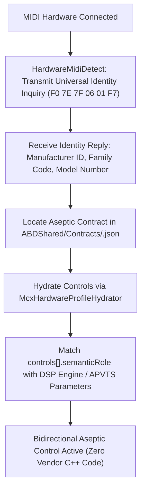

# ABDSynths — Universal Semantic Roles & Common Data Dictionary (CDD v2.0)

> **Canonical Reference & Single Source of Truth (SSOT)**  
> **Package:** `@abdsynths/contracts`  
> **Version:** `2.0.0`  
> **Status:** Ratified across `ABDShared`, `ABDBankManager`, `ABDNeuModMakr`, `ABDAudioLab`, and individual synthesizers (`ABDMCX0X`, `ABDMS2000`, `ABDAxioniK`, `ABDEep`, `ABDCZ101`, `ABDJUNiO601`).

---

## 1. Architectural Purpose & Contract Asepticism

In the `ABDSynths` architecture, **no software synth or hardware bridge may hardcode proprietary vendor parameters, MIDI CCs, or NRPNs in C++ DSP code**. All parameter bindings, UI controls, preset converters, and bidirectional hardware control bridges operate through **Semantic Roles** (`semanticRole`).

When an external hardware instrument (e.g. Roland MC-303, Boss DR-5, Korg MS2000, Behringer DeepMind 12, Casio CZ-101) is connected, it is auto-detected via MIDI Universal Identity Inquiry (`F0 7E 7F 06 01 F7`). The engine loads the corresponding aseptic JSON profile (`ABDShared/Contracts/<instrument>.json`). Every physical knob or wire command in that profile declares its `semanticRole`. The software engine connects its internal DSP parameters to physical controls via exact semantic role matching.

---

## 2. Taxonomy by Functional Category

### 2.1 Voice Allocation, Polyphony & Tuning (`voice`)
| `semanticRole` | Domain / Unit | Wire Default (GM/GS/XG) | Description & Synthesizer Context |
| :--- | :--- | :--- | :--- |
| `VoicePolyMode` | Enum (`Poly`, `Mono`, `Legato`) | — | Polyphony voice assign mode. |
| `VoiceUnisonVoices` | Integer [1..16] | — | Number of stacked unison voices (e.g. MS2000, DeepMind). |
| `VoiceUnisonDetune` | Cents [0..100] | — | Unison voice pitch spread / detuning amount. |
| `VoiceUnisonSpread` | % [0..100] | — | Stereo panning spread across unison voices. |
| `PortamentoGlideTime`| Seconds [0.0..10.0] / [0..127] | CC 5 (Portamento Time) | Time taken to glide between notes in mono or poly. |
| `PortamentoSwitch` | Boolean (On / Off) | CC 65 (Portamento Switch) | Enables or disables portamento glide. |
| `PortamentoMode` | Enum (`Auto`, `Always`) | — | Auto/Fingered glides only when legato keys overlap. |
| `PitchBendUpRange` | Semitones [0..24] / Cents | RPN 00 00 (Pitch Bend Sens) | Semitones pitch bend bends up at max deflection. |
| `PitchBendDownRange`| Semitones [0..24] / Cents | RPN 00 00 / SysEx | Semitones pitch bend bends down (independent range). |
| `MasterTuneCents` | Cents [-100..+100] | RPN 00 01 (Master Fine Tune)| Global instrument fine tuning. |

---

### 2.2 Oscillators, Noise & Rompler Partials (`oscillator`)
Supports multi-oscillator architectures (`Osc1`, `Osc2`, `Osc3`), Sub-Oscillators, Noise generators, and Rompler sample partials (`Partial1..4`).

| `semanticRole` | Domain / Unit | Wire / MIDI | Description & Synthesizer Context |
| :--- | :--- | :--- | :--- |
| `Osc[N]Waveform` | Enum (`Saw`, `Square`, `Pulse`, `Triangle`, `Sine`, `Noise`, `DWGS`, `PCM`) | MS2000 CC 80 / Patch | Primary oscillator core waveform. |
| `Osc[N]Octave` | Octaves [-3..+3] | Patch | Coarse octave transposition (16', 8', 4', 2'). |
| `Osc[N]CoarseTune` | Semitones [-24..+24] | Patch / NRPN | Coarse semitone offset. |
| `Osc[N]FineTune` | Cents [-50..+50] (Bipolar)| Patch / NRPN | Fine cents pitch offset. |
| `Osc[N]PulseWidth` | % [0..100] | DeepMind / MS2000 CC | Pulse width duty cycle for pulse/square waveforms. |
| `Osc[N]PulseWidthMod`| % [0..100] | DeepMind / MS2000 CC | LFO or Envelope modulation depth onto pulse width. |
| `Osc[N]Level` | Normalized [0.0..1.0] | Mixer CC / Patch | Oscillator volume in the pre-filter mixer stage. |
| `Osc[N]Pan` | Pan [-64..+63] (Bipolar)| Patch | Pre-filter stereo position of the oscillator. |
| `OscHardSync` | Boolean (On / Off) | MS2000 CC 81 / DeepMind | Forces slave oscillator phase restart on master cycle. |
| `OscRingMod` | Boolean / % [0..100] | MS2000 CC 82 / DeepMind | Multiplies oscillator outputs for bell/metallic sidebands. |
| `OscFmCrossMod` | % [0..100] | DeepMind / Roland Struct | Frequency modulation of Osc 1 frequency by Osc 2. |
| `OscKeyTrack` | % [0..200] / Ratio | Patch | Pitch tracking against MIDI note pitch (0% = drone). |
| `OscPhaseInit` | Degrees [0..360] | Patch | Initial phase restart per note-on (or free-running). |
| `SubOscLevel` | Normalized [0.0..1.0] | DeepMind / Juno CC | Sub-oscillator level in mixer stage. |
| `SubOscWaveform` | Enum (`Square`, `Pulse`, `Sine`) | Juno / DeepMind switch | Waveform generated by sub-oscillator (-1 or -2 oct). |
| `NoiseLevel` | Normalized [0.0..1.0] | MS2000 CC / DeepMind | Noise generator level in mixer stage. |
| `NoiseColor` | Enum (`White`, `Pink`, `Red`) | DeepMind / Patch | Spectral tilt and filtering of the noise source. |
| `SampleLoopMode` | Enum (`OneShot`, `Forward`, `PingPong`, `Reverse`) | Rompler / Sampler | Rompler / Sampler playback loop behavior. |
| `SampleStartOffset`| Frames / Normalized | Rompler / Sampler | Start playback offset into PCM sample. |
| `SampleAltStart` | Boolean (On / Off) | Roland MC / GS Part | Velocity or switch triggered alternate attack transient. |
| `SampleLoopTune` | Cents [-100..+100] | Rompler / Sampler | Fine pitch tuning of the sample sustain loop. |

---

### 2.3 Filters & Waveshapers (`filter`)
Supports classic Ladder, Roland TVF ZDF (TC6116AF Chamberlin), Korg MS20 acid, State Variable Filters (SVF), Comb filters, and Formant/Z-Plane filters.

| `semanticRole` | Domain / Unit | Wire Default (GM/GS/XG) | Description & Synthesizer Context |
| :--- | :--- | :--- | :--- |
| `FilterType` | Enum (`Ladder`, `SVF`, `RolandTVF`, `MS20Acid`, `Comb`, `Formant`) | Patch / CC 83 | Filter circuit topology / DSP algorithm. |
| `FilterMode` | Enum (`LPF6`, `LPF12`, `LPF18`, `LPF24`, `HPF6`, `HPF12`, `HPF24`, `BPF6`, `BPF12`, `BPF24`, `Notch`, `CombPos`, `CombNeg`, `Peaking`) | Patch / CC 83 | Frequency response passband characteristics. |
| `FilterCutoff` | Hz [20..20000] / [0..127] | CC 74 (Brightness / Cutoff) / GS NRPN 01 20 | Cutoff frequency of the primary filter. |
| `FilterResonance` | Q [0.5..30.0] / [0..127] | CC 71 (Harmonic / Reso) / GS NRPN 01 21 | Peak emphasis at cutoff; enables self-oscillation. |
| `FilterKeyTrack` | % [0..200] / Cents/key | Patch | Cutoff tracking proportionally to MIDI note number. |
| `FilterDrive` | dB [0..36] / Normalized | Patch / DeepMind Boost | Pre-filter or in-loop non-linear saturation. |
| `FilterEnvDepth` | Normalized [-1.0..+1.0] (Bipolar) | Patch / MS2000 CC / GS | Depth and polarity of filter envelope mod onto cutoff. |
| `FilterEnvVelocity` | % [0..100] | Patch / GS | Velocity sensitivity scaling filter envelope depth. |
| `FilterLfoDepth` | Normalized [0.0..1.0] | Patch / GS NRPN 01 09 | LFO modulation intensity onto filter cutoff. |
| `FilterMorph` | Normalized [0.0..1.0] | Patch | Continuous morphing between filter modes (e.g. LP -> BP -> HP).|
| `FilterCombFeedback`| Normalized [-0.99..+0.99] | Patch | Comb filter internal delay line feedback coefficient. |
| `FilterCombDamping` | Normalized [0.0..1.0] | Patch | High frequency loss in the comb feedback loop. |

---

### 2.4 Envelopes — Standard, Multi-Stage & Looping (`envelope`)
Supports classic ADSR, DADSR, DAHDSR, Roland 5-stage (`T1..T4`, `L0..L4`), Casio CZ 8-stage rate/level, and Hartmann Neuron neural envelopes. Envelopes can be instantiated as `AmpEnv*`, `FilterEnv*`, `PitchEnv*`, or arbitrary `ModEnv[N]*`.

| `semanticRole` | Domain / Unit | Wire Default (GM/GS/XG) | Description & Synthesizer Context |
| :--- | :--- | :--- | :--- |
| `[Prefix]EnvDelay` | Seconds [0.0..10.0] / ms | Patch | Pre-attack delay before envelope onset begins. |
| `[Prefix]EnvAttack` | Seconds [0.001..20.0] / [0..127] | CC 73 (Attack Time) / GS NRPN 01 63 | Time taken to ramp from initial level to peak level. |
| `[Prefix]EnvHold` | Seconds [0.0..10.0] / ms | Patch | Hold time maintaining peak level before decay begins. |
| `[Prefix]EnvDecay` | Seconds [0.001..30.0] / [0..127] | CC 75 (Decay Time) / GS NRPN 01 64 | Time taken to fall from peak level to sustain level. |
| `[Prefix]EnvSustain`| Normalized [0.0..1.0] / [0..127] | Patch | Steady-state level held while key remains pressed. |
| `[Prefix]EnvRelease`| Seconds [0.001..30.0] / [0..127] | CC 72 (Release Time) / GS NRPN 01 66 | Time taken to decay to zero after note-off. |
| `[Prefix]EnvStageCount` | Integer [1..16] | Patch | Number of active stages in multi-stage envelope. |
| `[Prefix]EnvStage[N]Time` | Seconds / ms / [0..99] | Patch (CZ Rate, Roland T) | Time/Rate duration to reach Stage N level. |
| `[Prefix]EnvStage[N]Level`| Normalized / [0..99] | Patch (CZ Level, Roland L) | Target level achieved at completion of Stage N. |
| `[Prefix]EnvStage[N]Curve`| Enum (`Linear`, `Exp`, `Log`, `SCurve`, `Lut`, `Hold`)| Patch | Mathematical curve geometry for stage interpolation. |
| `[Prefix]EnvSustainStage` | Integer [1..16] | Patch (CZ Sus Point) | Stage index that halts and sustains until note-off. |
| `[Prefix]EnvEndStage` | Integer [1..16] | Patch (CZ End Point) | Final stage index terminating the envelope. |
| `[Prefix]EnvLoopMode` | Enum (`Off`, `Forward`, `Alternating`) | Patch | Loop cycling behavior across envelope stages. |
| `[Prefix]EnvLoopStart` | Integer [1..16] | Patch | First stage index in the repeating cycle loop. |
| `[Prefix]EnvLoopEnd` | Integer [1..16] | Patch | Last stage index in the repeating cycle loop. |
| `[Prefix]EnvInvert` | Boolean (Normal / Inverted) | Patch | Inverts envelope output polarity (high becomes low). |
| `[Prefix]EnvDepth` | Normalized [-1.0..+1.0] (Bipolar) | Patch | Overall modulation depth applied to destination. |
| `[Prefix]EnvVelocity`| Normalized [0.0..1.0] | Patch | Velocity tracking scaling the envelope peak/time. |
| `[Prefix]EnvKeyTrack` | Normalized [-1.0..+1.0] | Patch | Keyboard tracking shortening envelope times on high keys.|

---

### 2.5 Low Frequency Oscillators (`lfo`)
Supports polyphonic and global LFOs (`Lfo1`, `Lfo2`, `Lfo[N]`).

| `semanticRole` | Domain / Unit | Wire Default (GM/GS/XG) | Description & Synthesizer Context |
| :--- | :--- | :--- | :--- |
| `[LfoN]Waveform` | Enum (`Sine`, `Triangle`, `SawUp`, `SawDown`, `Square`, `SampleAndHold`, `SmoothRandom`) | Patch | Shape of the modulation waveform. |
| `[LfoN]Rate` | Hz [0.01..100.0] / Divisions | CC 76 (Vibrato Rate) / GS NRPN 01 08 | Speed/frequency of LFO oscillation. |
| `[LfoN]TempoSync` | Boolean (Free / Synced) | Patch | Quantizes LFO rate to host DAW tempo divisions (1/4, 1/8T, etc.).|
| `[LfoN]Delay` | Seconds [0.0..10.0] / [0..127] | CC 78 (Vibrato Delay) / GS NRPN 01 0A | Silence interval before LFO modulation commences. |
| `[LfoN]FadeIn` | Seconds [0.0..10.0] / ms | Patch (DeepMind / Roland) | Gradual rise time ramp from zero to full LFO amplitude. |
| `[LfoN]KeySync` | Boolean (Free / Retrigger) | Patch | Resets LFO cycle phase to `PhaseOffset` on note-on. |
| `[LfoN]PhaseOffset`| Degrees [0..360] | Patch | Initial starting phase angle of the waveform. |
| `[LfoN]Polarity` | Enum (`Bipolar`, `Unipolar`) | DeepMind (Uni/Bi) | Bipolar centered on zero vs unipolar positive-only. |
| `[LfoN]Depth` | Normalized [0.0..1.0] / [0..127] | CC 77 (Vibrato Depth) / GS NRPN 01 09 | Master intensity of LFO modulation output. |

---

### 2.6 Modulation Matrix (`mod_matrix`)
Unified routing across all synthesizers (`abdeep_modulation_matrix.json`, `abdms2000_modulation_matrix.json`, `neuronik_modulation_matrix.json`, `axionikExpandedModel.ts`).

| `semanticRole` | Domain / Unit | Description & Synthesizer Context |
| :--- | :--- | :--- |
| `ModSlot[N]Source` | Enum / Identifier | Modulation source assigned to Bus Slot N (e.g. `LFO1`, `Env2`, `ModWheel`). |
| `ModSlot[N]Destination`| Enum / Identifier | Destination parameter target modulated by Bus Slot N. |
| `ModSlot[N]Amount` | Normalized [-1.0..+1.0] (Bipolar) | Bipolar depth and direction of modulation. |
| `ModSlot[N]ViaSource` | Enum / Identifier | Secondary attenuator modifier (e.g. Mod Wheel modulates LFO depth). |
| `ModSlot[N]ViaAmount` | Normalized [-1.0..+1.0] | Depth of secondary via attenuator control. |
| `ModSlot[N]Curve` | Enum (`Linear`, `Exp`, `SCurve`, `Gate`) | Mathematical transfer function shaping modulation signal. |

---

### 2.7 Physical Controls, Pedals & Performance Controllers (`performance`)
Complies with official MIDI 1.0 / GM / Roland GS / Yamaha XG standards.

| `semanticRole` | Standard MIDI CC | Domain / Behavior | Description |
| :--- | :--- | :--- | :--- |
| `ModulationWheel` | CC 1 | Unipolar [0..127] | Continuous mod wheel lever/wheel. |
| `BreathController` | CC 2 | Unipolar [0..127] | Wind/breath pressure sensor. |
| `FootController` | CC 4 | Unipolar [0..127] | General foot slider/controller. |
| `FootExpressionPedal`| CC 11 | Unipolar [0..127] | Dynamic volume/expression continuous pedal. |
| `SustainPedal` | CC 64 | Boolean / Continuous [0..127] | Damper/Hold pedal (supports half-pedaling). |
| `PortamentoSwitch` | CC 65 | Boolean [0..127] (>=64 On)| Portamento glide toggle pedal. |
| `SostenutoPedal` | CC 66 | Boolean [0..127] (>=64 On)| Sostenuto pedal (holds only currently depressed notes). |
| `SoftPedal` | CC 67 | Boolean [0..127] (>=64 On)| Una Corda / Soft attenuation pedal. |
| `ChannelAftertouch` | Channel Pressure | Unipolar [0..127] | Monophonic keybed pressure. |
| `PolyAftertouch` | Poly Key Pressure | Unipolar [0..127] (Per Note) | Individual per-key pressure sensor. |
| `PitchBendWheel` | Pitch Bend | Bipolar [-8192..+8191] | Center-sprung pitch bend wheel or lever. |
| `VectorJoystickX` | CC 16 / Vector X | Bipolar [-64..+63] | 2D vector joystick horizontal axis. |
| `VectorJoystickY` | CC 17 / Vector Y | Bipolar [-64..+63] | 2D vector joystick vertical axis. |
| `RibbonController` | CC 12 / Pitch | Bipolar / Unipolar | Touch-sensitive position and pressure ribbon. |

---

### 2.8 Effects & Sends (`effects`)
Covers GM, GS, XG, and studio rack multi-effects processors.

| `semanticRole` | Wire Default | Description & Synthesizer Context |
| :--- | :--- | :--- |
| `ReverbType` | Patch / SysEx | Algorithm (`Room1..3`, `Hall1..2`, `Plate`, `Delay`, `PanDelay`). |
| `ReverbTime` | SysEx / CC | Decay time in seconds / 0..127. |
| `ReverbPreDelay` | SysEx / CC | Pre-delay time in ms before early reflections appear. |
| `ReverbDamp` | SysEx / CC | High-frequency damping absorption factor. |
| `ReverbMix` | SysEx / CC | Wet/dry balance of the master reverb processor. |
| `PartReverbSend` | CC 91 | Channel/Part send level routed into master reverb bus. |
| `DelayType` | Patch / SysEx | Algorithm (`Mono`, `StereoPingPong`, `TapeEcho`, `CrossFeedback`). |
| `DelayTime` | SysEx / CC | Delay time in ms or host tempo divisions. |
| `DelayTempoSync` | Boolean | Quantizes delay time to host BPM. |
| `DelayFeedback` | % [0..100] | Feedback regeneration amount (echo count). |
| `DelayHighCut` | Hz / [0..127] | Low-pass damping filter on delayed reflections. |
| `DelayLowCut` | Hz / [0..127] | High-pass rumble filter on delayed reflections. |
| `DelayMix` | SysEx / CC | Wet/dry balance of the master delay processor. |
| `PartDelaySend` | CC 94 | Channel/Part send level routed into master delay bus. |
| `ChorusType` | Patch / SysEx | Algorithm (`Chorus1..4`, `FeedbackChorus`, `Flanger`, `ShortDelay`). |
| `ChorusRate` | CC / SysEx | Modulation speed in Hz. |
| `ChorusDepth` | CC / SysEx | Delay line sweep depth. |
| `ChorusFeedback`| % [0..100] | Resonant flanging feedback amount. |
| `ChorusMix` | SysEx / CC | Wet/dry balance of the master chorus processor. |
| `PartChorusSend` | CC 93 | Channel/Part send level routed into master chorus bus. |
| `PhaserDepth` | CC 95 | Master phaser effect sweep depth. |
| `TremoloDepth` | CC 92 | Amplitude tremolo modulation depth. |
| `DistortionDrive`| % [0..100] | Overdrive / distortion saturation drive amount. |
| `DistortionTone` | Normalized | Tone EQ tilt of the distortion processor. |
| `EqLowGain` | dB [-12..+12] | Master low-shelf equalizer gain. |
| `EqHighGain` | dB [-12..+12] | Master high-shelf equalizer gain. |

---

### 2.9 Multi-Part Mixer & Drum Key Slots (`part_mixer` & `drum`)
Dedicated to multi-timbral structured romplers (e.g. `ABDMCX0X`, Roland SC-55 / MC-303, Boss DR-5).

| `semanticRole` | Wire Default | Description |
| :--- | :--- | :--- |
| `PartVolume` | CC 7 | Part level in multi-timbral mix [0..127]. |
| `PartBalance` | CC 8 | Stereo balance. |
| `PartPan` | CC 10 | Part stereo position (0 = Left, 64 = Center, 127 = Right). |
| `PartMute` | Boolean | Mutes part audio generation. |
| `PartSolo` | Boolean | Solos part in multi-timbral mix. |
| `DrumKeyPitch` | GS NRPN 18 hh | Semitones / cents pitch tuning for specific drum key note `hh`. |
| `DrumKeyLevel` | GS NRPN 1A hh | Output level volume for specific drum key note `hh`. |
| `DrumKeyPan` | GS NRPN 1C hh | Stereo panning position for specific drum key note `hh`. |
| `DrumKeyReverbSend`| GS NRPN 1D hh | Reverb send amount for specific drum key note `hh`. |
| `DrumKeyChorusSend`| GS NRPN 1E hh | Chorus send amount for specific drum key note `hh`. |
| `DrumKeyDelaySend` | GS NRPN 1F hh | Delay send amount for specific drum key note `hh`. |

---

## 3. Dynamic Hydration & Hardware Auto-Detection Workflow

