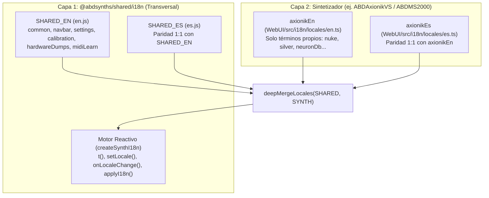

# 🌐 Estándar de Internacionalización (`i18n`) en 2 Capas para la Suite ABDSynths

> **Ubicación en `ABDShared`:** [`Components/I18n/`](../../Components/I18n/index.js)  
> **Exportación oficial:** `@abdsynths/shared/i18n` (o `@abdsynths/shared/components`)  
> **Estado:** Estándar Normativo de Arquitectura (Adoptado en `ABDAxionikVS` y obligatorio para nuevos sintetizadores de la familia).

---

## 1. Principio Arquitectónico: Modelo Híbrido en 2 Capas (Core + Synth)

Para evitar tanto la duplicación de traducciones entre plugins como el acoplamiento del núcleo compartido a la jerga exclusiva de un modelo concreto, toda la internacionalización de la suite **ABDSynths** se rige por una arquitectura estricta en **dos capas**:



### 1.1 ¿Qué pertenece a la Capa 1 (`@abdsynths/shared/i18n`)?
Todo vocabulario y funcionalidad **común a 2 o más sintetizadores**:
- **`common`**: Acciones universales (`Close`, `Save`, `Cancel`, `Load`, `Export`, `Import`, `Reset`, `Reset All`, `Search...`, `ALL`, `Min`, `Max`, `Default`, `MODIFIED`, `Apply`, `Discard`, etc.).
- **`navbar` estándar**: Menús (`File`, `Edit`, `Mode`, `View`, `Help`), carga/guardado de bancos y presets, `Zoom`, `Color Theme`, `Language`, `Check for Updates...`, `About...`, e indicadores HUD (`PRESET:`, `VOICES:`, `CPU`).
- **`settings` comunes**: Polifonía, panorama, rango de Pitch Bend, escala de interfaz y selector de tema.
- **`calibration` UI**: Controles del cajón de calibración DSP (`LOAD JSON`, `EXPORT JSON`, `MODIFIED`, `RESET ALL`, `Reset Group`, tooltips de doble clic y marcadores de fábrica).
- **`hardwareDumps` UI**: Estado de conexión MIDI, solicitud/envío de volcados `.syx`, `Live SysEx Inspector`, Diff A/B y registro de actividad.
- **`midiLearn` UI**: Textos de la matriz de mapeo MIDI Learn ($N:M$), menú contextual y acciones de exportación/importación.

### 1.2 ¿Qué pertenece a la Capa 2 (`<Synth>/WebUI/src/i18n/locales/`)?
Únicamente los términos **exclusivos del dominio de ese sintetizador**:
- En **`ABDAxionikVS`**: `nuke` (*"NUKE Remote Control Unit"*), `silver`, `neuronDb`, `oracleCard` (*"Clip-to-Zero 0x1000bc40"*) y las descripciones técnicas específicas de sus constantes DSP.
- En **`ABDMS2000`**: *Virtual Patch*, *Mod Sequence*, *Vocoder*, *DWGS*.
- En **`ABDJUNiO601`**: *Chorus I/II*, *DCO*, *HPF*, etc.

---

## 2. Regla de Oro: Acrónimos Universales de Síntesis (NO Traducir)

> [!IMPORTANT]
> En el diseño de instrumentos musicales profesionales, las abreviaturas de serigrafía de panel y los acrónimos técnicos universales **JAMÁS se traducen** a ningún idioma.

**Lista canónica de términos invariables:**
- Etapas de envolvente en una letra: **`A`**, **`D`**, **`S`**, **`R`**, **`T1..T4`**, **`L1..L4`**.
- Módulos y parámetros universales: **`LFO`**, **`VCO`**, **`DCO`**, **`VCF`**, **`VCA`**, **`HPF`**, **`LPF`**, **`BPF`**, **`CUTOFF`**, **`RESO`**, **`PWM`**, **`FM`**, **`AM`**, **`SYNC`**, **`PAN`**.
- Protocolos y unidades: **`MIDI`**, **`CC`**, **`NRPN`**, **`SysEx`**, **`Hz`**, **`kHz`**, **`dB`**, **`ms`**, **`st`**, **`ct`**.
- Nombres propios de arquitectura (ej. en Neuron): **`Resynator`**, **`Scape`**, **`Sphere`**, **`Blender`**, **`Slicer`**, **`Silver`**, **`NUKE`**, **`NeuronDB`**.

**¿Qué SÍ se traduce?**
- Nombres de menús, acciones, botones de gestión, títulos de cajones (*drawers*), ayudas emergentes (*tooltips*), diálogos modales, mensajes de estado/error y explicaciones técnicas de calibración.

---

## 3. Guía Paso a Paso de Integración en un Sintetizador

### Paso 1: Crear las extensiones de idioma del sintetizador (`en.ts` y `es.ts`)

En `WebUI/src/i18n/locales/en.ts`:
```typescript
import { SHARED_EN, deepMergeLocales } from '@abdsynths/shared/i18n';

export const synthEn = {
  navbar: {
    // Sobrescribe o añade claves específicas del sinte
    about: 'About ABDMySynth...',
    aboutTitle: 'ABDMySynth',
    aboutSubtitle: 'Classic Virtual Synthesizer',
  },
  myCustomPanel: {
    drawerTitle: 'CUSTOM MODULE',
  },
};

export const en = deepMergeLocales(SHARED_EN, synthEn);
export type Translations = typeof en;
```

En `WebUI/src/i18n/locales/es.ts`:
```typescript
import { SHARED_ES, deepMergeLocales } from '@abdsynths/shared/i18n';
import type { Translations } from './en.js';

export const synthEs: typeof import('./en.js').synthEn = {
  navbar: {
    about: 'Acerca de ABDMySynth...',
    aboutTitle: 'ABDMySynth',
    aboutSubtitle: 'Sintetizador Virtual Clásico',
  },
  myCustomPanel: {
    drawerTitle: 'MÓDULO PERSONALIZADO',
  },
};

export const es: Translations = deepMergeLocales(SHARED_ES, synthEs);
```

### Paso 2: Instanciar el motor en `WebUI/src/i18n/index.ts`

```typescript
import { createSynthI18n, collectLocaleKeys } from '@abdsynths/shared/i18n';
import { synthEn, en, type Translations } from './locales/en.js';
import { synthEs, es } from './locales/es.js';

export type Locale = 'en' | 'es';
export { en, es, synthEn, synthEs, collectLocaleKeys };

const i18n = createSynthI18n<Locale, Translations>({
  locales: {
    en: synthEn,
    es: synthEs,
  },
  defaultLocale: 'en',
  storageKey: 'abdsynths.locale', // Clave compartida en toda la suite ABDSynths
});

export const {
  initI18n,
  getLocale,
  setLocale,
  onLocaleChange,
  t,
  applyI18n,
} = i18n;
```

### Paso 3: Uso en Componentes (Programático y Declarativo)

1. **Inicialización en `main.ts`**:
   ```typescript
   import { initI18n } from './i18n/index.js';
   initI18n();
   ```
2. **Traducción programática e interpolación**:
   ```typescript
   t('common.close'); // -> "Close" (EN) / "Cerrar" (ES)
   t('custom.greeting', { count: 12 });
   ```
3. **Atributos declarativos en HTML (`applyI18n`)**:
   ```html
   <span data-i18n="navbar.menuFile">File</span>
   <button data-i18n-title="navbar.btnMidiTitle">MIDI</button>
   <input data-i18n-placeholder="common.search" />
   ```
4. **Reacción en vivo al cambio de idioma sin recargar ni cortar el audio**:
   ```typescript
   onLocaleChange((newLocale) => {
     this.render();
   });
   ```

---

## 4. Cómo Añadir un Nuevo Idioma en el Futuro (ej. Francés `fr`)

Gracias al diseño desacoplado de diccionarios planos:
1. En `ABDShared/Components/I18n/locales/`, duplicar `en.js` como `fr.js` (`SHARED_FR`) y traducir las cadenas comunes una sola vez para toda la suite.
2. En el sintetizador (`WebUI/src/i18n/locales/`), duplicar `en.ts` como `fr.ts` y traducir únicamente las cadenas específicas del sintetizador.
3. Registrar `fr` en `createSynthI18n`. **No es necesario modificar ningún componente ni lógica de interfaz.**

---

## 5. Test Obligatorio de Paridad (`tests/i18n.test.ts`)

Todo sintetizador de la suite debe incluir un test automatizado en Vitest utilizando `collectLocaleKeys` de `@abdsynths/shared/i18n` que garantice que ninguna clave quede sin traducir entre idiomas:

```typescript
import { SHARED_EN, SHARED_ES, collectLocaleKeys } from '@abdsynths/shared/i18n';
import { en, synthEn } from '../WebUI/src/i18n/locales/en';
import { es, synthEs } from '../WebUI/src/i18n/locales/es';

it('mantiene 100% de paridad de claves entre EN y ES', () => {
  expect(collectLocaleKeys(SHARED_EN)).toEqual(collectLocaleKeys(SHARED_ES));
  expect(collectLocaleKeys(synthEn)).toEqual(collectLocaleKeys(synthEs));
  expect(collectLocaleKeys(en)).toEqual(collectLocaleKeys(es));
});
```
