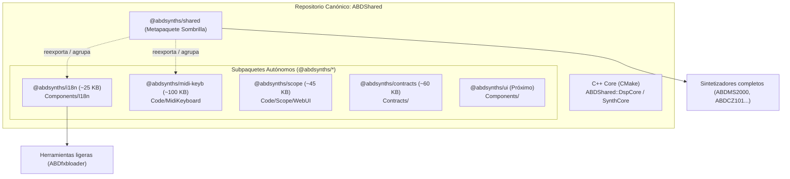

# 📦 Estándar de Modularización y Subpaquetes — ABDShared

> **Propósito:** Esta norma de arquitectura define cómo se estructuran, publican y consumen los paquetes modulares dentro de **`ABDShared`**, evitando tanto el sobrepeso innecesario de dependencias (*"monolito de 72 MB"*) como la duplicación y riesgo de forks (*política Zero-Copy / Zero-Fork*).

---

## 1. El Problema que Resuelve la Modularización

Históricamente, `ABDShared` integraba en un único paquete npm (`@abdsynths/shared`):
- Motores DSP en C++20 sin JUCE (`Code/`)
- Teclado virtual interactivo (`Code/MidiKeyboard`)
- Esquemas de contratos JSON y hardware profiles (`Contracts/`)
- Componentes WebUI ESM (`Components/`)
- Motor universal de internacionalización (`Components/I18n/`)
- Assets pesados: imágenes de fondo PNG/WebP, fuentes, metrología (`Assets/`, ~65 MB)

Cuando una aplicación ligera o herramienta satélite (como `ABDfxbloader` o `ABDBankManager`) solo necesita traducir su interfaz con `i18n` (< 25 KB), instalar el paquete raíz le obligaba a descargar **72 MB** de C++ y gráficos de sintetizadores que jamás usará.

---

## 2. Los Tres Pilares de la Arquitectura Modular



### Pilar 1: Atomización en Subpaquetes Autónomos
Cada módulo con frontera clara e independiente se convierte en un subpaquete npm autónomo con su propio `package.json`, control de versión SemVer y suite de pruebas.

### Pilar 2: El "Metapaquete Sombrilla" (*Umbrella Package*)
El paquete raíz `@abdsynths/shared` **nunca se destruye ni se eliminan sus exports**. Permanece como un metapaquete que depende y reexporta los subpaquetes. Esto garantiza **compatibilidad retroactiva 100%**: los sintetizadores existentes que sigan importando `from '@abdsynths/shared/i18n'` continuarán funcionando sin modificar ni una sola línea de código.

### Pilar 3: Política Zero-Fork / Zero-Copy
Bajo ningún concepto se copiarán archivos `.js` o `.ts` de `ABDShared` dentro de otros proyectos para "evitar dependencias". Toda herramienta debe consumir el paquete canónico mediante el gestor de paquetes (`pnpm workspace`, Git Subdirectory o GitHub Packages).

---

## 3. Checklist Obligatorio para Crear un Nuevo Subpaquete

Para atomizar un nuevo módulo (ejemplo: `@abdsynths/<nombre>`):

1. **`package.json` en su directorio:**
   Debe declarar:
   - `"name": "@abdsynths/<nombre>"`
   - `"version": "1.0.0"`
   - `"type": "module"`
   - `"main"`, `"types"`, y el bloque `"exports"`
   - `"files"` acotado estrictamente a los archivos necesarios para producción (evitando tests, notas o scratch)
   - `"publishConfig": { "registry": "https://npm.pkg.github.com", "access": "restricted" }`
   - `"repository"` apuntando a `ABDShared.git` indicando su `"directory"`

2. **Registro en el Workspace pnpm (`pnpm-workspace.yaml`):**
   Añadir la ruta del subpaquete en `pnpm-workspace.yaml` de la raíz del monorepo `ABDSynths`:
   ```yaml
   packages:
     - ABDShared
     - ABDShared/Code/MidiKeyboard
     - ABDShared/Components/I18n
     # - ABDShared/NuevoSubpaquete
   ```

3. **Reexportación en `@abdsynths/shared` (`ABDShared/package.json`):**
   - Añadir la dependencia `"@abdsynths/<nombre>": "workspace:*"`
   - Mantener el path canónico en `"exports"` apuntando a la nueva ubicación para no romper consumidores legacy.

4. **Flujo Automatizado en CI/CD (`.github/workflows/publish-packages.yml`):**
   - Registrar el nuevo subpaquete en el step de publicación hacia GitHub Packages (`npm.pkg.github.com`).

---

## 4. Matriz de Consumo Según el Tipo de Proyecto

| Entorno del Consumidor | Sintaxis en `package.json` | Resolución |
|---|---|---|
| **Sintetizador en el Monorepo** | `"@abdsynths/i18n": "workspace:*"` | Symlink instantáneo gestionado por `pnpm` (Zero-Copy). |
| **Herramienta Satélite Git (ej. ABDfxbloader)** | `"@abdsynths/i18n": "github:ajabadia/ABDShared#main&path:Components/I18n"` | npm 9+ clona y empaqueta exclusivamente ese subdirectorio. |
| **Entorno CI/CD / Release Oficial** | `"@abdsynths/i18n": "^1.0.0"` | Descarga directa del tarball de 25 KB desde GitHub Packages. |
| **Sintetizador Legacy (sin migrar)** | `"@abdsynths/shared": "workspace:*"` | Sigue importando `@abdsynths/shared/i18n` sin cambios. |

---

## 5. Inventario de Subpaquetes Actuales y Candidatos

| Paquete | Directorio | Estado | Peso | Propósito |
|---|---|---|---|---|
| **`@abdsynths/i18n`** | `Components/I18n/` | **Activo** | **29 KB** | Motor reactivo en 2 capas, cero dependencias. |
| **`@abdsynths/midi-keyb`** | `Code/MidiKeyboard/` | **Activo** | **~100 KB** | Teclado virtual interactivo multi-plataforma. |
| **`@abdsynths/contracts`** | `Contracts/` | **Activo** | **61 KB** | Schemas JSON, perfiles SysEx y specs de modelos (SSOT). |
| **`@abdsynths/scope`** | `Code/Scope/WebUI/` | **Activo** | **~45 KB** | Visualizador universal lock-free (Oscilloscope, FFT, Lissajous, PhaseMeter, VuMeter, Spectrogram). |
| **`@abdsynths/ui`** | `Components/` | *Candidato Fase 2* | ~400 KB | Componentes UI Web (Knobs, Sliders, FitStage, etc.). |
| **`@abdsynths/assets`** | `Assets/` | *Candidato Fase 3* | ~65 MB | Fondos, skins completas y fuentes tipográficas. |

### Nota sobre la Arquitectura Dual de Scope
Scope posee una estructura desacoplada en dos capas:
1. **C++ Real-Time Core (`ABDShared::ScopeCore` / `ScopeCoreHeaders`):** Motor lock-free en C++20 que reside en `Code/Scope/` y se enlaza mediante CMake a los sintetizadores JUCE para capturar el buffer de audio en el audio thread sin bloqueos ni asignaciones dinámicas.
2. **Frontend WebUI (`@abdsynths/scope`):** Paquete ESM autónomo publicado desde `Code/Scope/WebUI/` que renderiza las señales en Canvas 2D/WebGL en el browser o en la WebView de JUCE. Puede consumirse directamente en cualquier aplicación web o herramienta de análisis sin necesidad del backend C++.
